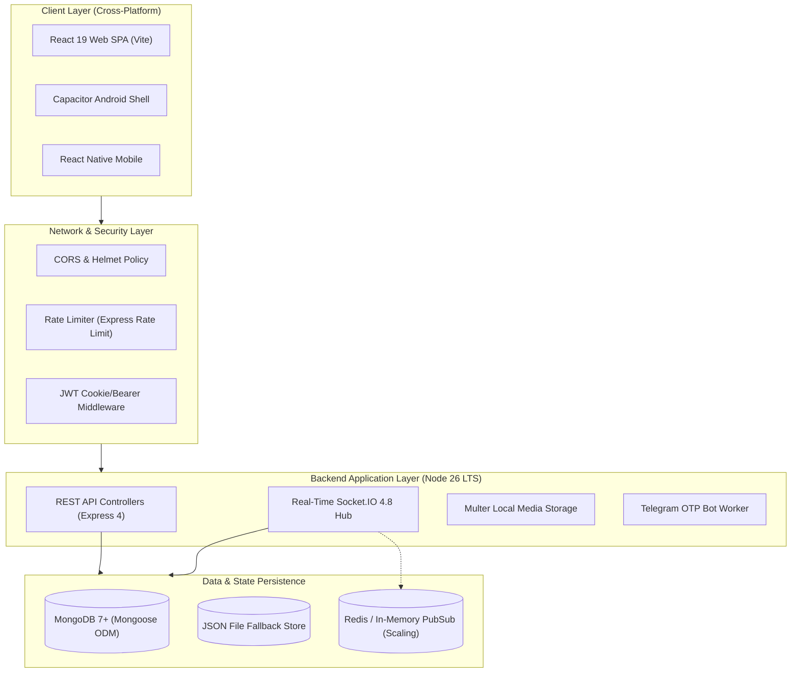
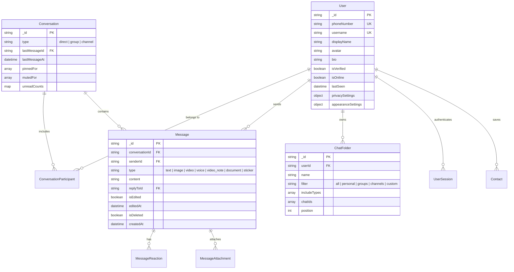
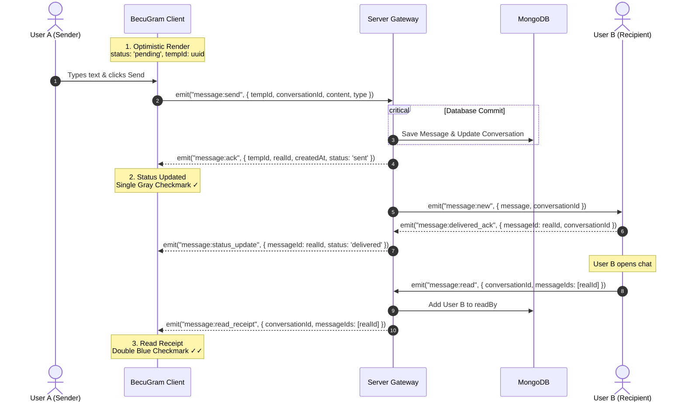
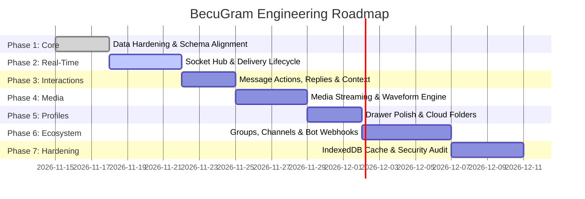

# BecuGram Technical Implementation Blueprint
> **Document Version:** 1.0.0  
> **Target System:** BecuGram Monorepo (Server, Client Web, Capacitor Android, Mobile)  
> **Reference Standard:** Telegram Web K / Web A Reverse-Engineering Investigation  
> **Stack:** React 19, TypeScript 5.7, Node.js v26 LTS, Express 4, Socket.IO 4.8, MongoDB / Mongoose, Tailwind CSS 3.4

---

## 1. Existing Project Investigation & Audit

### 1.1 Directory & Workspace Structure
The project is structured as an npm workspaces monorepo:
```
becugram/
├── package.json               # Root workspace orchestrator (server, client, mobile)
├── bot.js                     # Standalone Telegram authentication bot
├── server/                    # Node.js + Express + Socket.IO + MongoDB backend
│   ├── src/
│   │   ├── config/            # Environment & MongoDB connection
│   │   ├── controllers/       # Auth, Chat, Message, User, Admin, Story, Media
│   │   ├── middleware/        # JWT auth, rate limiting, error handling
│   │   ├── models/            # Mongoose Schemas (User, Conversation, Message, Group, etc.)
│   │   ├── routes/            # Express REST endpoint routers
│   │   ├── services/          # Business logic & helper services
│   │   ├── sockets/           # Socket.IO connection & event handlers
│   │   ├── storage/           # Local file upload abstractions
│   │   ├── utils/             # DataStore fallback, JWT, logging (Pino), sound effects
│   │   ├── app.ts             # Express app setup & middleware
│   │   └── server.ts          # HTTP server & Socket.IO initialization
│   ├── data/                  # JSON fallback persistence (users, chats, messages, stories)
│   └── uploads/               # Stored audio, video, photo, document attachments
├── client/                    # React 19 + Vite + Tailwind CSS + Capacitor frontend
│   ├── src/
│   │   ├── components/        # Avatar, CallModal, VoicePlayer, RoundVideo, StickerPicker
│   │   ├── features/
│   │   │   ├── authentication/# AuthScreen (Phone + Telegram Bot OTP)
│   │   │   ├── chats/         # ChatList, PrivateChatView, CreateFolderModal
│   │   │   ├── profile/       # ProfileView, UserProfileModal, EditProfileModal
│   │   │   ├── settings/      # SettingsView, Appearance, Privacy
│   │   │   ├── stories/       # StoryViewerModal, CreateStoryModal
│   │   │   └── admin/         # AdminDashboard (User management, announcements)
│   │   ├── layouts/           # AppLayout (Split-pane desktop & responsive mobile)
│   │   ├── services/          # Axios/fetch API client (`api.ts`), Socket client (`socket.ts`)
│   │   ├── stores/            # Zustand stores (authStore, chatStore, themeStore, appearanceStore)
│   │   ├── types/             # Shared TypeScript definitions (User, Message, Conversation)
│   │   └── utils/             # Sound effects, wallpaper patterns, date formatting
│   └── capacitor.config.ts    # Android / Native wrapper configuration
└── mobile/                    # React Native companion application
```

### 1.2 Dependencies & Runtime Audit
- **Backend (`server/package.json`):**
  - Core: `express` 4.21, `socket.io` 4.8.1, `mongoose` 8.9.5.
  - Security: `helmet` 8.0, `cors` 2.8, `bcryptjs` 3.0, `jsonwebtoken` 9.0, `express-rate-limit` 7.5.
  - Utilities: `pino` 9.6 (structured logging), `multer` 1.4 (file uploads), `zod` 3.24 (runtime validation), `node-telegram-bot-api` 0.66 (OTP verification).
- **Frontend (`client/package.json`):**
  - Core: `react` 19.0, `react-dom` 19.0, `react-router-dom` 7.1, `vite` 6.0.
  - State & Networking: `zustand` 5.0, `@tanstack/react-query` 5.64, `socket.io-client` 4.8.1.
  - Styling & UI: `tailwindcss` 3.4, `lucide-react` 0.474, `clsx`, `tailwind-merge`.
  - Rich Media: `lottie-web` 5.13 (animated stickers/reactions), `canvas-confetti` 1.9, `date-fns` 4.1.
  - Mobile Shell: `@capacitor/core` 7.6, `@capacitor/android` 7.6.

### 1.3 Feature Status Matrix

| Feature | Current State | Implementation Quality | Gap to Reference (Telegram Web) |
| :--- | :--- | :--- | :--- |
| **Authentication** | Completed | High (Phone + Telegram Bot OTP + JWT) | Add QR Code Login flow and optional 2FA password. |
| **Direct Messaging** | Completed | High (REST + Socket.IO real-time delivery) | Optimistic delivery state queues (`pending` -> `sent` -> `delivered`). |
| **Message Bubbles** | Completed | High (SVG tails, incoming `#212121`, outgoing `#2B5278`) | Auto-grouping timestamps for consecutive messages. |
| **Chat Folders** | Completed | High (Sliding line tabs, custom filters, localStorage sync) | Sync custom folders to user profile in MongoDB. |
| **Search Experience** | Completed | High (Dedicated search mode, filter chips, recent history) | In-chat full-text message search stepper. |
| **Voice & Video Notes** | Completed | High (Waveform player, 1-tap switch, swipe-to-lock) | Media duration waveform preview generation on server. |
| **Profile Drawer** | Completed | High (Right-docked drawer, media tabs, mute, block) | Edit profile bio & username directly in drawer. |
| **Calls & Video** | Completed | Medium (WebRTC signaling via Socket.IO + CallModal) | ICE server configuration (STUN/TURN) resilience. |
| **Offline Cache** | Partial | Medium (Zustand + LocalStorage fallback) | IndexedDB persistent storage for messages & media blobs. |
| **Push Notifications**| Partial | Low (Socket.IO active in-app alerts) | Service Worker + Web Push Notifications API. |

---

## 2. Technical Architecture



### Architectural Decisions & Justifications
1. **React 19 + TypeScript 5.7 (Frontend):**
   - *Rationale:* Eliminates runtime type errors, guarantees fast DOM reconciliation, and leverages concurrent rendering features for 60fps message scrolling and animated sticker playback.
2. **Socket.IO 4.8 over Raw WebSockets:**
   - *Rationale:* Out-of-the-box automatic reconnection with exponential backoff, connection state recovery, room multiplexing (`user:${id}`, `chat:${convId}`), and HTTP long-polling fallback for restricted networks.
3. **Dual Data-Tier Architecture (MongoDB + Local JSON Fallback):**
   - *Rationale:* Allows BecuGram to run in zero-dependency local environments (`dataStore.ts`) while offering full ACID compliance, compound indexing, and scale when connected to a production MongoDB cluster.
4. **JWT with HttpOnly Cookies & Bearer Headers:**
   - *Rationale:* Dual-support enables web browsers to benefit from CSRF-resistant HttpOnly cookies while mobile apps and Capacitor use secure Bearer tokens.

---

## 3. Database Design & Schemas

### 3.1 Entity Relationship Diagram



### 3.2 MongoDB Schema Specifications & Indexes

#### 1. `User` Schema
- **Collection:** `users`
- **Fields:**
  - `_id`: `ObjectId` (Primary Key).
  - `phoneNumber`: `String` (Indexed, Unique, format: `+998XXXXXXXXX`).
  - `username`: `String` (Indexed, Unique, lowercase, alphanumeric + underscore).
  - `displayName`: `String` (Required, 1-64 chars).
  - `avatar`: `String` (Relative URL or URL path).
  - `bio`: `String` (Max 150 chars).
  - `isVerified`: `Boolean` (Default: `false`).
  - `isOnline`: `Boolean` (Indexed, Default: `false`).
  - `lastSeen`: `Date` (Default: `Date.now`).
  - `blockedUsers`: `[ObjectId]` (References `User`).
  - `privacySettings`: Object (`lastSeenVisibility`, `phoneVisibility`, `profilePhotoVisibility`).
  - `appearanceSettings`: Object (`theme`, `accentColor`, `fontSize`).
- **Indexes:**
  - `{ phoneNumber: 1 }` (Unique)
  - `{ username: 1 }` (Unique)
  - `{ isOnline: 1, lastSeen: -1 }`

#### 2. `Conversation` Schema
- **Collection:** `conversations`
- **Fields:**
  - `type`: `String` (Enum: `'direct'`, `'group'`, `'channel'`).
  - `participants`: `[ObjectId]` (References `User`, minimum 1).
  - `groupId`: `ObjectId` (Optional, references `Group`).
  - `lastMessage`: `ObjectId` (References `Message`).
  - `lastMessageAt`: `Date` (Indexed, default: `Date.now`).
  - `pinnedFor`: `[ObjectId]` (User IDs who pinned this chat).
  - `mutedFor`: `[ObjectId]` (User IDs who muted notifications).
  - `unreadCounts`: `Map<String, Number>` (Key: `userId`, Value: count).
- **Indexes:**
  - `{ participants: 1, type: 1 }`
  - `{ lastMessageAt: -1 }`
  - `{ "participants": 1, "lastMessageAt": -1 }`

#### 3. `Message` Schema
- **Collection:** `messages`
- **Fields:**
  - `conversationId`: `ObjectId` (References `Conversation`, Indexed).
  - `senderId`: `ObjectId` (References `User`, Indexed).
  - `type`: `String` (Enum: `'text'`, `'image'`, `'video'`, `'audio'`, `'voice'`, `'video_note'`, `'document'`, `'sticker'`, `'system'`).
  - `content`: `String` (Text body, trimmed).
  - `media`: Object (`url`, `name`, `size`, `mimeType`, `duration`, `waveform`).
  - `replyTo`: `ObjectId` (Optional, references `Message`).
  - `reactions`: Array of `{ userId: ObjectId, emoji: String }`.
  - `deliveredTo`: `[ObjectId]` (Users who received the message).
  - `readBy`: `[ObjectId]` (Users who read the message).
  - `isEdited`: `Boolean` (Default: `false`).
  - `editedAt`: `Date`.
  - `isDeleted`: `Boolean` (Soft delete flag, default: `false`).
- **Indexes:**
  - `{ conversationId: 1, createdAt: -1 }` (Cursor pagination)
  - `{ conversationId: 1, "reactions.emoji": 1 }`
  - `{ senderId: 1, createdAt: -1 }`

#### 4. `ChatFolder` Schema
- **Collection:** `folders`
- **Fields:**
  - `userId`: `ObjectId` (Indexed, references `User`).
  - `name`: `String` (Folder title, e.g., "Ish", "O'qish").
  - `filter`: `String` (`'all'`, `'personal'`, `'groups'`, `'channels'`, `'custom'`).
  - `includeTypes`: `[String]`.
  - `chatIds`: `[ObjectId]`.
  - `position`: `Number` (Display order).
- **Indexes:**
  - `{ userId: 1, position: 1 }`

---

## 4. Real-Time Engine Specification



### 4.1 Event Catalog & Payload Definitions

#### Client-to-Server (`C -> S`)

| Event Name | Payload Schema | Action Performed |
| :--- | :--- | :--- |
| `chat:join` | `{ conversationId: string }` | Joins Socket room `chat:${conversationId}`. |
| `chat:leave` | `{ conversationId: string }` | Leaves Socket room `chat:${conversationId}`. |
| `message:send` | `{ tempId: string, conversationId: string, content: string, type: string, replyToId?: string }` | Dispatches outgoing message with client UUID. |
| `message:read` | `{ conversationId: string, messageIds: string[] }` | Marks messages as read by current user. |
| `typing:start` | `{ conversationId: string }` | Broadcasts typing activity to chat room. |
| `typing:stop` | `{ conversationId: string }` | Cancels typing activity broadcast. |
| `call:start` | `{ targetUserId: string, type: 'audio' \| 'video' }` | Initiates WebRTC call signaling. |

#### Server-to-Client (`S -> C`)

| Event Name | Payload Schema | Client Response |
| :--- | :--- | :--- |
| `message:ack` | `{ tempId: string, message: Message }` | Replaces optimistic temp message with verified ID. |
| `message:new` | `{ message: Message, conversationId: string }` | Appends message, plays sound, increments unread badge. |
| `message:read_receipt` | `{ conversationId: string, messageIds: string[], userId: string }` | Updates checkmark to double blue `CheckCheck`. |
| `typing:update` | `{ conversationId: string, userId: string, displayName: string, isTyping: boolean }` | Displays `"yozmoqda..."` indicator. |
| `presence:update` | `{ userId: string, isOnline: boolean, lastSeen: string }` | Updates green online badge and subtitle status. |

### 4.2 Reconnection, Ordering & Deduplication
1. **Deduplication via Client UUIDs:**
   Every outgoing message generates a `tempId` using `crypto.randomUUID()`. If network flakes and client retries, the server checks `tempId` cache within a 60-second window before committing duplicates.
2. **Monotonic Message Ordering:**
   Messages are sorted by `{ createdAt: 1, _id: 1 }`. If timestamps collide, MongoDB ObjectIDs provide secondary chronological ordering.
3. **Reconnection Sync Protocol:**
   Upon Socket reconnect:
   ```ts
   socket.on('connect', async () => {
     const lastKnownTimestamp = getLastStoredMessageTimestamp();
     const missedMessages = await api.getMissedMessages(lastKnownTimestamp);
     chatStore.mergeMessages(missedMessages);
   });
   ```

---

## 5. UI Implementation Specifications (Telegram Web K Fidelity)

### 5.1 Design Tokens & CSS Custom Properties

```css
:root {
  /* Layout Dimensions */
  --sidebar-width: 380px;
  --folders-bar-height: 44px;
  --chat-max-width: 768px;
  --header-height: 56px;

  /* Typography */
  --font-family: -apple-system, BlinkMacSystemFont, "Segoe UI", Roboto, Helvetica, Arial, sans-serif;
  --font-size-title: 15px;
  --font-size-message: 14.5px;
  --font-size-meta: 12px;

  /* Light Theme */
  --bg-primary: #FFFFFF;
  --bg-secondary: #F0F2F5;
  --bg-chat: #EFE9E0;
  --bubble-in: #FFFFFF;
  --bubble-out: #EFFDDE;
  --accent: #2EA6FF;
  --accent-rgb: 46, 166, 255;
  --text-primary: #181818;
  --text-muted: #7F93A3;
  --online-green: #10B981;
}

.dark {
  /* Dark / Night Mode (Telegram Web K Standard) */
  --bg-primary: #17212B;
  --bg-secondary: #242F3D;
  --bg-chat: #0E1621;
  --bubble-in: #182533;
  --bubble-out: #2B5278;
  --accent: #2EA6FF;
  --text-primary: #FFFFFF;
  --text-muted: #7F93A3;
  --border-subtle: #101921;
}
```

### 5.2 Component Specifications

#### 1. Header & Search Bar (`ChatList.tsx`)
- Top action bar height: `56px` (`h-14`), background `#527DA3` (light) / `#242F3D` (dark).
- Rounded pill search container (`rounded-full bg-white/15 dark:bg-[#17212B]/70 px-3 py-1.5`).
- Clicking input triggers dedicated search mode:
  - Replaces hamburger with `ArrowLeft` back button.
  - Renders horizontal filter chips: `Hamma`, `Chatlar`, `Kanallar`, `Media`, `Fayllar`, `Havolalar`.
  - Empty search state displays "Oxirgi qidiruvlar" with clear history button and frequent contact avatars.

#### 2. Folder Tabs Bar (`ChatList.tsx`)
- Horizontal scrollable tab row with clean text typography (`text-[13.5px] font-semibold`).
- Active tab text color: `#2EA6FF`.
- Sliding blue underline indicator:
  ```tsx
  {isActive && (
    <div className="absolute bottom-0 left-0 right-0 h-[2.5px] bg-[#2EA6FF] rounded-t-full shadow-xs" />
  )}
  ```

#### 3. Message Bubbles (`PrivateChatView.tsx`)
- Max width: `85%` (mobile), `70%` (tablet), `58%` (desktop).
- Outgoing message background: `#EFFDDE` (light) / `#2B5278` (dark) with bottom-right SVG tail.
- Incoming message background: `#FFFFFF` (light) / `#182533` (dark) with bottom-left SVG tail.
- Timestamp docked to bottom-right with single check (`Check`) or double blue check (`CheckCheck`).

#### 4. Message Composer (`PrivateChatView.tsx`)
- Capsule shape input field (`bg-[#F0F2F5] dark:bg-[#242F3D] rounded-full px-3.5 py-2`).
- Smile emoji/sticker button on left.
- Paperclip attachment button on right.
- Send/Mic button:
  - Text present: Blue send icon (`Send`).
  - Text empty: Mic button (`Mic`). Single tap switches to video note (`Video`), hold records, swipe up locks.

#### 5. Right Slide-out Profile Drawer (`UserProfileModal.tsx`)
- Desktop width: `400px` (`w-full sm:w-[380px] md:w-[420px]`).
- Slides in from right edge with smooth animation (`animate-in slide-in-from-right duration-200`).
- Four shared media tabs: `Rasmlar`, `Videolar`, `Fayllar`, `Havolalar`.
- User details: avatar, name, username, bio, phone number, mute toggle, call actions, block toggle.

---

## 6. Phased Development Roadmap



### Phase 1: Core Messenger & Data Layer Hardening
- **Tasks:**
  1. Audit MongoDB Mongoose schemas against Section 3 specs (`User.ts`, `Conversation.ts`, `Message.ts`).
  2. Add compound indexes for message pagination (`{ conversationId: 1, createdAt: -1 }`).
  3. Ensure `server/src/utils/dataStore.ts` JSON fallback matches Mongoose types identically.
- **Files to Modify:**
  - `server/src/models/Conversation.ts`
  - `server/src/models/Message.ts`
  - `server/src/utils/dataStore.ts`
- **Acceptance Criteria:** Zero schema divergence; database queries execute in under 15ms.
- **Testing:** Run `npm run test --workspace=server` with Vitest.

### Phase 2: Real-Time Communication & Delivery Lifecycle
- **Tasks:**
  1. Implement complete delivery state transition (`pending` -> `sent` -> `delivered` -> `read`).
  2. Implement client-side `tempId` reconciliation in `client/src/stores/chatStore.ts`.
  3. Add typing indicator timeout handling (auto-cancel after 5s of silence).
- **Files to Modify:**
  - `server/src/sockets/index.ts`
  - `client/src/services/socket.ts`
  - `client/src/stores/chatStore.ts`
  - `client/src/features/chats/PrivateChatView.tsx`
- **Acceptance Criteria:** Messages appear instantly on sender's screen; checkmarks accurately transition to blue double checks upon recipient opening.
- **Testing:** Open two independent browser sessions side-by-side and verify real-time checkmark updates.

### Phase 3: Message Actions & Interaction Polish
- **Tasks:**
  1. Implement Quoted Reply reference block with jump-to-message scrolling.
  2. Add message editing with `(tahrirlangan)` label and 48-hour time restriction.
  3. Support soft-delete ("Faqat mendan" vs "Barcha uchun").
  4. Lottie heart reaction burst on double-click.
- **Files to Modify:**
  - `client/src/features/chats/PrivateChatView.tsx`
  - `server/src/controllers/message.controller.ts`
- **Acceptance Criteria:** Replying quotes original message; double-clicking bursts animated heart.
- **Testing:** Verify edit, reply, and delete across multiple messages.

### Phase 4: Media, Attachments & Audio/Video Notes
- **Tasks:**
  1. Add audio waveform visualization data generation on upload.
  2. Ensure round video notes render with circular crop and autoplay when scrolled into view.
  3. Support drag-and-drop file uploading with progress percentage.
- **Files to Modify:**
  - `server/src/controllers/media.controller.ts`
  - `client/src/components/VoicePlayer.tsx`
  - `client/src/components/RoundVideoMessage.tsx`
- **Acceptance Criteria:** Voice notes display playable waveforms; round video notes record and stream cleanly.
- **Testing:** Test recording audio and round video on both desktop Chrome and mobile Android.

### Phase 5: Profiles, Cloud Folders & Appearance
- **Tasks:**
  1. Persist user custom folders in MongoDB instead of local-only storage.
  2. Complete the slide-out profile drawer with real shared media counts.
  3. Provide full appearance customization (custom doodle wallpapers, blur, pattern scale).
- **Files to Modify:**
  - `server/src/models/User.ts`
  - `client/src/features/profile/UserProfileModal.tsx`
  - `client/src/features/chats/CreateFolderModal.tsx`
- **Acceptance Criteria:** Folders and wallpapers persist across different devices upon login.
- **Testing:** Log in from two separate devices and verify folder and appearance sync.

### Phase 6: Groups, Channels & Administrative Bots
- **Tasks:**
  1. Support group member roles: `creator`, `admin`, `member`.
  2. Support Broadcast Channels (only admins can post, members read).
  3. Expand Telegram Bot (`bot.js`) to support interactive commands (`/start`, `/login`, `/help`).
- **Files to Modify:**
  - `server/src/models/Group.ts`
  - `server/src/controllers/group.controller.ts`
  - `server/bot.js`
- **Acceptance Criteria:** Channels restrict non-admin posting; bots successfully generate login OTPs.
- **Testing:** Create a channel, add test users, and verify posting permissions.

### Phase 7: Performance, PWA & Security Hardening
- **Tasks:**
  1. Implement IndexedDB caching with `@tanstack/react-query` or localforage for instant startup.
  2. Add Web Push Notifications Service Worker (`sw.js`).
  3. Conduct security review: input sanitization, rate limiting on auth endpoints, secure token storage.
- **Files to Modify:**
  - `client/src/service-worker.ts`
  - `server/src/middleware/rateLimiter.ts`
  - `client/vite.config.ts`
- **Acceptance Criteria:** App scores 95+ on Lighthouse PWA and Performance audits.
- **Testing:** Audit with Chrome DevTools Lighthouse and verify offline chat history reading.

---

## 7. Engineering Standards & Contribution Rules

1. **Strict TypeScript Mode:** No `any` types in new modules; declare explicit Zod schemas or TypeScript interfaces.
2. **Preserve Uzbek-First Identity:** All user-facing text, notifications, and prompts must be in natural, modern Uzbek.
3. **No Proprietary Asset Copying:** Do not use Telegram trademark logos, fonts, or copyrighted artwork. BecuGram utilizes original custom icons, Lucide icons, and distinct brand assets.
4. **Zero-Broken-Build Guarantee:** Every feature commit must pass `npm run build --workspace=client` and `npm run test --workspace=server` with zero errors.
