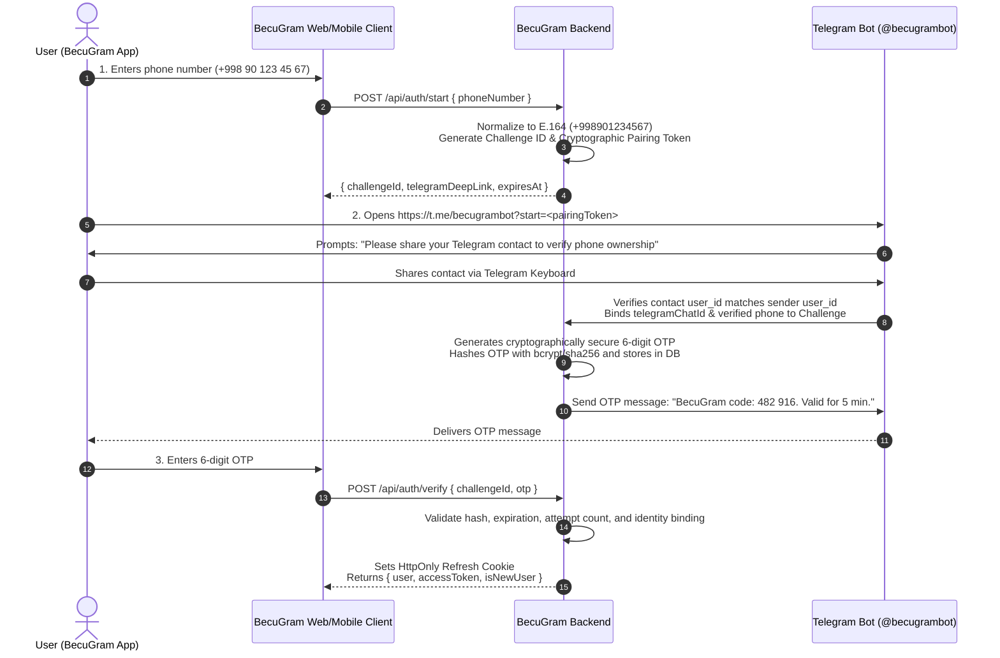

# BECUGRAM — Phone & Telegram Bot Authentication Flow

## Overview
BecuGram implements a secure, privacy-first authentication system that combines phone number identification with Telegram Bot cryptographic pairing and OTP verification.

This prevents SMS toll fraud, bypasses expensive telecommunication aggregators, and prevents phone-spoofing attacks by requiring explicit verification via Telegram's native `request_contact` protocol.

## Security Safeguards
1. **Never Trust Unverified Input:** A phone number submitted via the web client is marked as `PENDING_PAIRING` until Telegram's native contact verification confirms that the Telegram account transmitting the contact owns that exact MSISDN.
2. **Contact Spoofing Defense:** When the Telegram Bot receives a shared contact, it checks `contact.user_id === message.from.id`. Forwarded or forged contact objects are instantly rejected.
3. **One-Time Password Hashing:** OTP codes are hashed using `crypto.createHash('sha256')` with a server salt before being stored in MongoDB. Raw OTP codes are never logged or stored in plaintext.
4. **Rate Limiting & Expiration:**
   - Challenge lifetime: 10 minutes.
   - OTP lifetime: 5 minutes.
   - Maximum failed attempts: 5 per challenge before permanent invalidation.
   - Resend cool-down: 45 seconds.
5. **Token Issuance & Rotation:**
   - Short-lived Access Token (15 minutes).
   - Long-lived Refresh Token (30 days) with token family rotation and reuse detection.
   - HttpOnly, SameSite=Strict, Secure cookies for browser storage.

