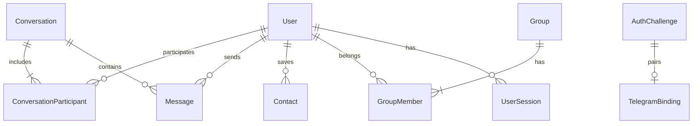

# BECUGRAM — Database Schema & Data Models

Engine: MongoDB Atlas / Local MongoDB via Mongoose ODM.

## Entity Relationship Overview

## Collections & Schemas

### 1. `users`
- `_id`: ObjectId
- `phoneNumber`: String, Unique, Sparse, Indexed (E.164 normalized)
- `telegramChatId`: String, Sparse, Indexed
- `telegramUserId`: String, Sparse, Indexed
- `username`: String, Unique, Indexed, Lowercase
- `displayName`: String
- `avatar`: String (URL or storage key)
- `bio`: String
- `isVerified`: Boolean (default: false)
- `isOnline`: Boolean (default: false)
- `lastSeen`: Date
- `privacySettings`:
  - `lastSeenVisibility`: Enum ('everyone', 'contacts', 'nobody')
  - `phoneVisibility`: Enum ('everyone', 'contacts', 'nobody')
  - `profilePhotoVisibility`: Enum ('everyone', 'contacts', 'nobody')
- `notificationSettings`:
  - `privateChats`: Boolean
  - `groupChats`: Boolean
  - `soundEnabled`: Boolean
  - `messagePreview`: Boolean
- `appearanceSettings`:
  - `theme`: Enum ('dark', 'light', 'system')
  - `accentColor`: String
  - `fontSize`: Enum ('small', 'medium', 'large')
- `blockedUsers`: [ObjectId -> User]
- `createdAt`, `updatedAt`: Timestamps

### 2. `conversations`
- `_id`: ObjectId
- `type`: Enum ('direct', 'group')
- `participants`: [ObjectId -> User]
- `lastMessage`: ObjectId -> Message
- `lastMessageAt`: Date (Indexed)
- `pinnedFor`: [ObjectId -> User]
- `mutedFor`: [ObjectId -> User]
- `unreadCounts`: Map(UserId -> Number)
- `createdAt`, `updatedAt`: Timestamps

### 3. `messages`
- `_id`: ObjectId
- `conversationId`: ObjectId -> Conversation (Indexed)
- `senderId`: ObjectId -> User (Indexed)
- `type`: Enum ('text', 'image', 'video', 'audio', 'voice', 'document', 'system')
- `content`: String
- `media`:
  - `url`: String
  - `name`: String
  - `size`: Number
  - `mimeType`: String
  - `duration`: Number (for audio/voice)
- `replyTo`: ObjectId -> Message (Populated with quote preview)
- `reactions`: Array of `{ userId: ObjectId, emoji: String }`
- `deliveredTo`: [ObjectId -> User]
- `readBy`: [ObjectId -> User]
- `isEdited`: Boolean
- `editedAt`: Date
- `isDeleted`: Boolean
- `createdAt`: Date (Indexed compound: { conversationId: 1, createdAt: -1 })

### 4. `groups`
- `_id`: ObjectId
- `name`: String
- `description`: String
- `avatar`: String
- `creatorId`: ObjectId -> User
- `inviteCode`: String, Unique, Indexed
- `memberCount`: Number
- `isPublic`: Boolean
- `createdAt`, `updatedAt`: Timestamps

### 5. `contacts`
- `userId`: ObjectId -> User (Owner)
- `contactUserId`: ObjectId -> User (Target)
- `customName`: String (optional)
- Compound Index: `{ userId: 1, contactUserId: 1 }` Unique

### 6. `auth_challenges`
- `_id`: ObjectId
- `phoneNumber`: String (Indexed)
- `pairingToken`: String (Unique, Indexed)
- `otpHash`: String
- `telegramChatId`: String
- `telegramUserId`: String
- `status`: Enum ('PENDING_PAIRING', 'PAIRED', 'VERIFIED', 'EXPIRED')
- `attempts`: Number (default: 0)
- `expiresAt`: Date (TTL Index)
- `createdAt`: Date

